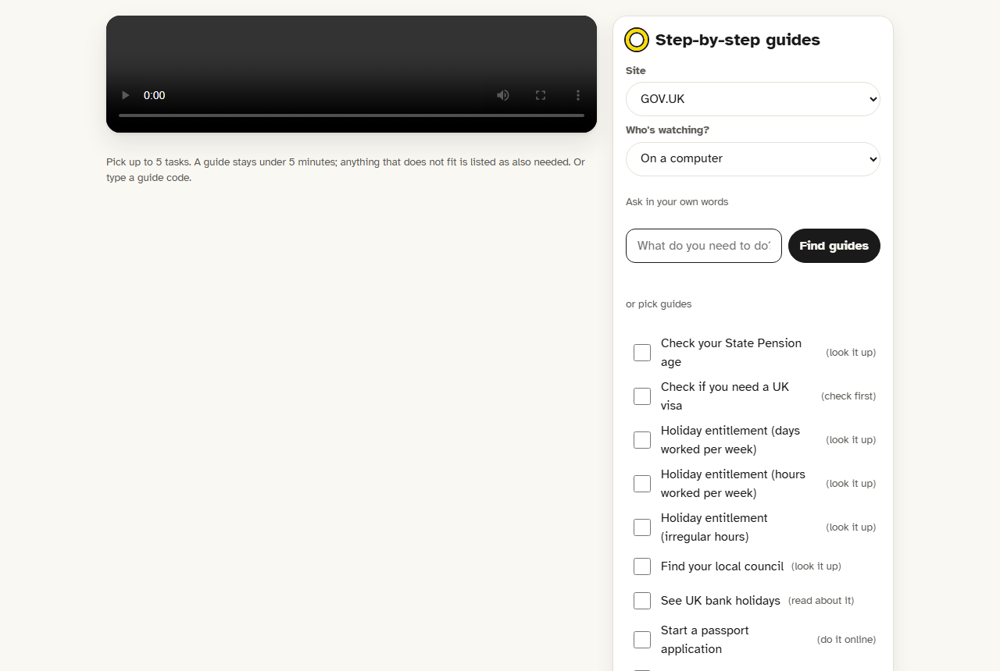
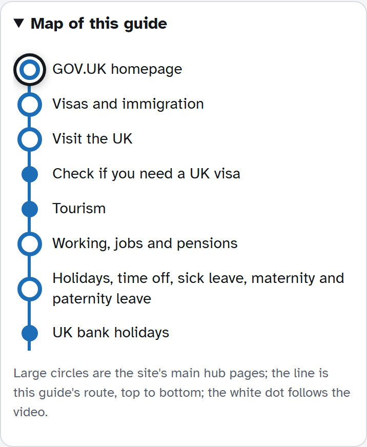
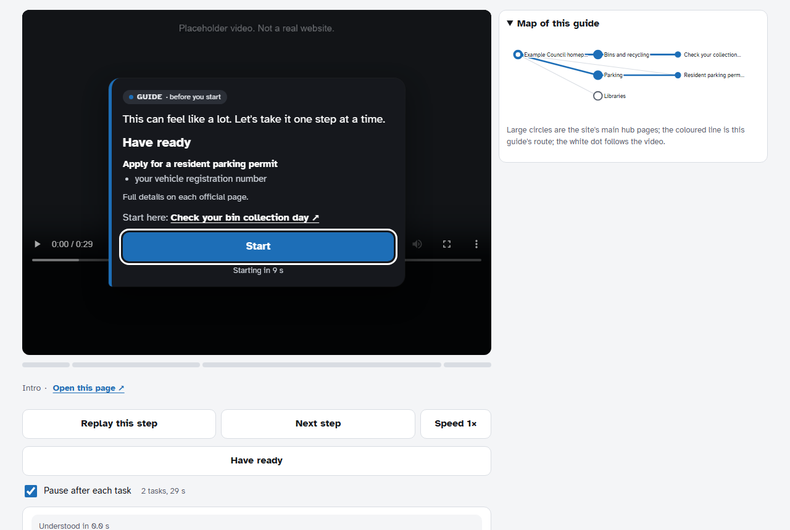
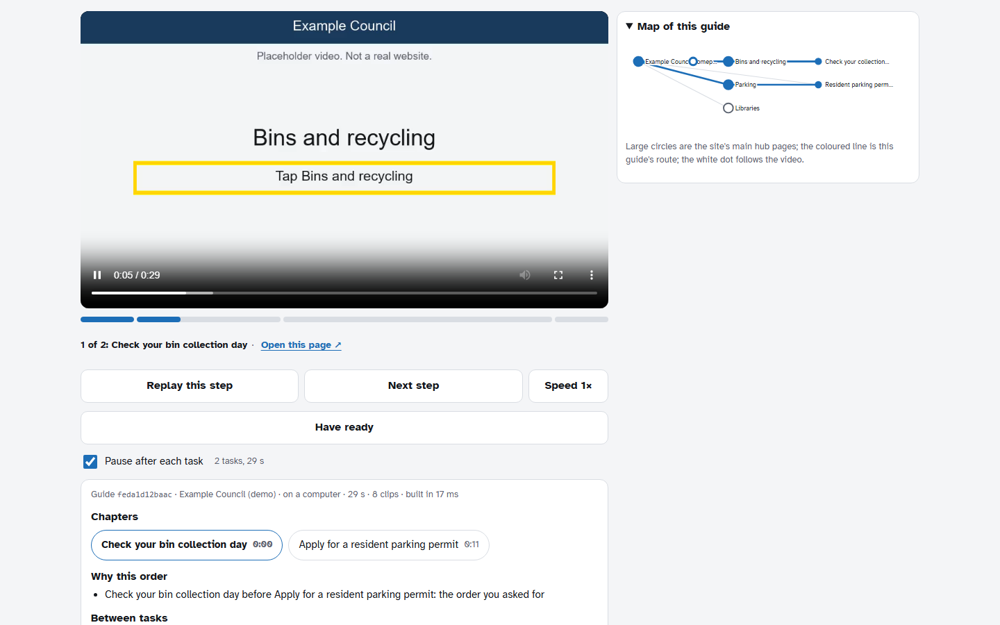
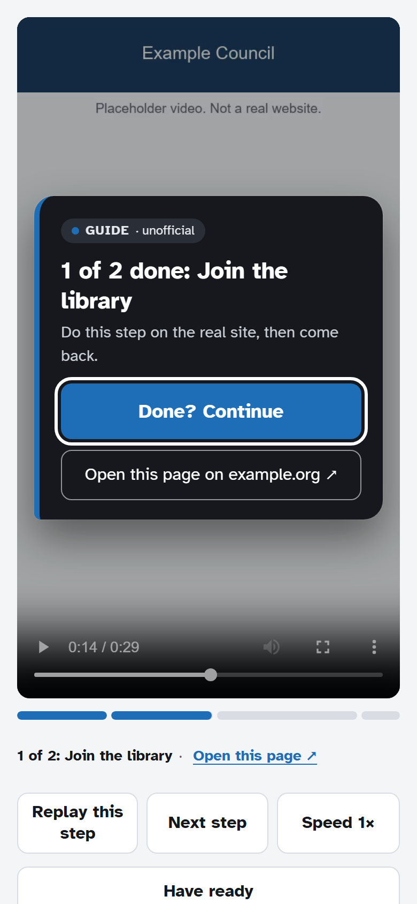
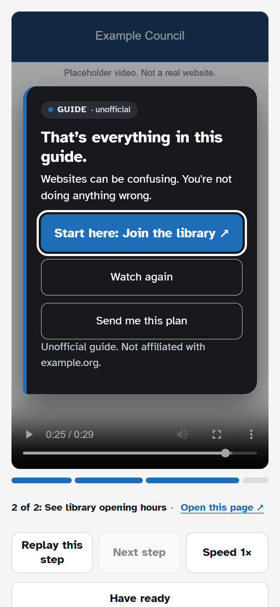

# how3 guide player

My grandma messaged me: *"I'm on the website. Where do I click?"* I sent her a screenshot. She replied: *"My screen doesn't look like that."*

So I built step-by-step guides. You say what you need in your own words and get a short video of every step on the official website: filmed on a phone or a computer, one task at a time, with a pause after each task so you can do it for real.

https://github.com/user-attachments/assets/3a250029-b668-4572-9e7f-4f7aa93e008c

## Try it

**https://guides.quasimodal.click**

Pick the website, then ask in your own words. For example:

- **GOV.UK:** "My aunt is visiting the UK"
- **Ireland:** "I'm bringing my car into Ireland"
- **Queensland Government:** "I need to renew my Queensland driver licence"

It works on a phone or a computer.

| | |
|---|---|
|  |  |
| The main page (live site) | The route map on a phone (live site) |
|  |  |
| The start screen (local version) | The player and its map (local version) |
|  |  |
| The pause after each task (local version) | The end screen (local version) |

## What's in the player

- **Start screen.** It has a short reassurance line and **Have ready** (what each task says you'll need). **Start here** links to the official page where the first task begins. A computer counts down; a phone waits for a tap, so sound works.
- **Pause after each task.** The player stops at the end of each task: do the step on the real site, then **Done? Continue**.
- **Controls.** Replay this step, Next step, and a slower speed (0.75×) that keeps the voice natural.
- **Progress.** The bar is split by task. The line under it names the current task and links to its official page.
- **Route map.** On a computer it's a graph of the site's main pages with the guide's route. On a phone it's one line, top to bottom. A dot follows the video.
- **Plan card.** It shows chapters, why the tasks are in this order, the way back between tasks, and what didn't fit.
- **Send me this plan.** You get the plan as a message to text or email, or as a page.

## How it fits together

This repo is the part people see and use: the main page, the guide finder and the guide player.

```
src/            the pages (main page, player, Follow-Through) and their pure functions
demo/           a small server that answers the pages' API from a fixture
demo/fixtures/  "Example Council": a made-up site with four tasks
demo/media/     placeholder video clips (title cards), cut into HLS segments
public/         fonts and the vendored hls.js
tests/          unit tests and a server test
```

On the live site, the videos come from a separate, private pipeline that films and narrates each step on the official website. A language model powers the finder there. [API.md](API.md) describes what the pages expect from a backend.

## Run the player locally (for developers)

The local version uses placeholder clips and made-up example tasks (bins, a library card, a parking permit) so it runs with no backend, keys or accounts. The real guides are on the live site.

You need Node.js 22.9 or later. There are no dependencies.

```
git clone https://github.com/QuasiModalLabs/how3-guide-player.git
cd how3-guide-player
npm install
npm run dev
```

Then open http://127.0.0.1:8787/. Try "when are my bins collected" or "I need a parking permit", or tick a few guides and press **Build and play**. The local finder matches keywords; it doesn't use a language model.

- `npm test` runs the tests.
- To try it on your phone, set `HOST=0.0.0.0` in a `.env` file (see `.env.example`) and open your computer's address on port 8787.
- `npm run make:video` remakes the placeholder clips after you change the fixture (needs ffmpeg). The clips are already committed.

## Notice

Unofficial demo. Not affiliated with GOV.UK, the Queensland Government, the Revenue Commissioners, the Department of Transport or any other government website the live site shows. The live-site screenshots contain public sector information licensed under the Open Government Licence v3.0. Example Council is fictional.

## Licence

MIT, see [LICENSE](LICENSE). The fonts (Atkinson Hyperlegible, SIL Open Font License) and hls.js (Apache 2.0) keep their own licences. Made by QuasiModal Labs.
